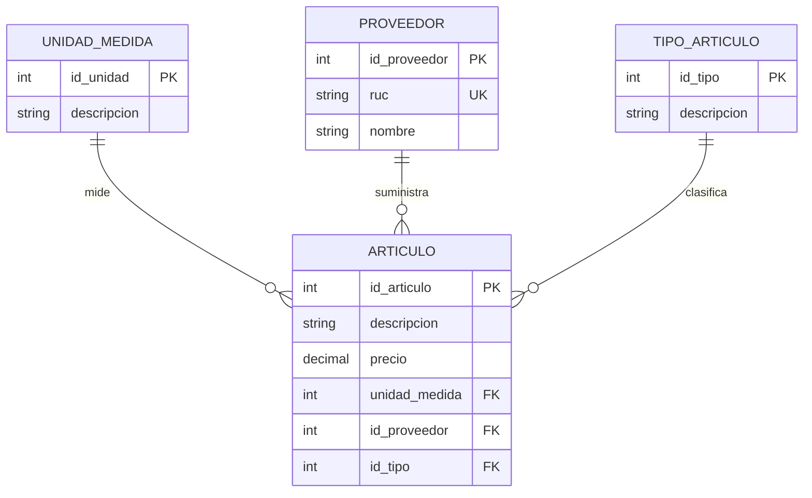

# Abastecimiento SIS

Portal de consulta de medicamentos e insumos para centros de salud del Seguro Integral de Salud. Incluye CRUD de medicamentos y proveedores, comparación de precios y búsqueda de proveedores por nombre o RUC.

Desarrollado con **Java 25, Spring Boot 4.1.1, Spring Data JPA, Thymeleaf y PostgreSQL 17**.

## Ejecutar el proyecto

Requisitos: JDK 25, Docker con Docker Compose y acceso a Internet para descargar las dependencias en la primera ejecución. El proyecto incluye Maven Wrapper.

Desde la carpeta del proyecto, en PowerShell:

```powershell
docker compose up -d
docker compose exec postgres pg_isready -U postgres -d abastecimiento
.\mvnw.cmd spring-boot:run
```

Espera a que PostgreSQL indique que acepta conexiones antes de iniciar Spring Boot. En Linux/macOS, el comando equivalente de Maven es `./mvnw spring-boot:run`.

| Página | Dirección |
|---|---|
| Portal de consultas | http://localhost:8080/ |
| Probador interactivo del CRUD | http://localhost:8080/api |
| Medicamentos en JSON | http://localhost:8080/api/articulos |
| Proveedores en JSON | http://localhost:8080/api/proveedores |
| Unidades de medida en JSON | http://localhost:8080/api/unidades-medida |
| Tipos de artículo en JSON | http://localhost:8080/api/tipos-articulo |

El esquema se crea con [schema.sql](src/main/resources/schema.sql) y los registros iniciales se cargan con [data.sql](src/main/resources/data.sql). En una base nueva se cargan **50 artículos, 10 proveedores, 8 unidades de medida y 9 tipos de artículo (incluido «Sin clasificar»)**. Los artículos incluyen medicamentos e insumos médicos.

## Agregar medicamentos a un proveedor

En el portal principal, busca al proveedor por nombre o RUC y pulsa **Ver y agregar medicamentos**. Verás su lista y un formulario para registrar el medicamento con ID nuevo, nombre, precio, presentación y tipo. El proveedor se toma de la selección; no necesitas escribir su ID.

Al guardar se confirma la operación y se actualizan la lista y el contador del proveedor. El contador representa registros de artículos asociados, no cantidades de stock. Si un medicamento lo ofrecen dos proveedores, cada oferta se registra con su propio ID y precio; crear una oferta no mueve la de otro proveedor. Los IDs repetidos se rechazan sin sobrescribir datos.

`GET /api/proveedores/{id}/articulos` devuelve solo los artículos de ese proveedor (lista vacía si no tiene ninguno y 404 si no existe). El formulario reutiliza `POST /api/articulos` y sus validaciones. Cambiar `idProveedor` por PUT reasigna un artículo existente; los contadores se recalculan desde la base al consultar. Un proveedor con artículos asociados no puede eliminarse.

Si el guardado se confirma pero falla la recarga de la lista, la página indica **Medicamento guardado** y permite actualizar sin volver a crearlo. Un fallo de conexión durante el POST requiere consultar la lista antes de reintentar, porque la respuesta podría haberse perdido.

## Probar el CRUD desde el navegador

Entra a **http://localhost:8080/api**, elige el recurso y la operación, completa los campos y pulsa **Ejecutar**. La página muestra la petición, el JSON de respuesta y el estado HTTP.

Para crear se indica un **ID entero positivo nuevo**. Los IDs son manuales. Para consultar, actualizar o eliminar se utiliza el ID del registro existente.

| Operación | Método HTTP | Medicamentos | Proveedores | Respuesta correcta |
|---|---|---|---|---|
| Crear | POST | `/api/articulos` | `/api/proveedores` | 201 + registro creado |
| Listar | GET | `/api/articulos` | `/api/proveedores` | 200 + lista |
| Consultar por ID | GET | `/api/articulos/{id}` | `/api/proveedores/{id}` | 200 + registro |
| Actualizar | PUT | `/api/articulos/{id}` | `/api/proveedores/{id}` | 200 + registro actualizado |
| Eliminar | DELETE | `/api/articulos/{id}` | `/api/proveedores/{id}` | 204, sin cuerpo |

### Demostración desde F12 → Console

Abre la consola del navegador mientras estás en **http://localhost:8080/api**. Ejecuta los bloques en orden. Se usan **ID 101** y **RUC 20999999999**: deben estar libres antes de iniciar. Si ya ejecutaste la demostración, consulta o elimina sus registros antes de repetir la creación.

Primero pega esta función de ayuda. Utiliza `fetch` y muestra el estado HTTP y el cuerpo de cada respuesta:

```javascript
var api = async (ruta, metodo = 'GET', datos) => {
  var respuesta = await fetch('/api/' + ruta, {
    method: metodo,
    headers: datos ? {'Content-Type': 'application/json'} : {},
    body: datos ? JSON.stringify(datos) : undefined
  });
  var texto = await respuesta.text();
  var resultado = texto ? JSON.parse(texto) : null;
  console.log('HTTP', respuesta.status, resultado);
  if (!respuesta.ok) throw new Error(resultado?.detail || 'La operación falló');
  return resultado;
};
```

**1. CREATE — insertar.** Crea primero el proveedor y luego su medicamento. La unidad `1` es Tableta:

```javascript
await api('proveedores', 'POST', {
  idProveedor: 101,
  ruc: '20999999999',
  nombre: 'Proveedor Demo'
});

await api('articulos', 'POST', {
  idArticulo: 101,
  descripcion: 'Medicamento Demo',
  precio: 2.50,
  idUnidad: 1,
  idProveedor: 101,
  idTipo: 9
});
```

Ambas peticiones deben devolver **201**.

**2. READ — consultar.** Lista los registros y consulta los dos que acabas de crear:

```javascript
console.table(await api('proveedores'));
console.table(await api('articulos'));
await api('proveedores/101');
await api('articulos/101');
```

Las consultas deben devolver **200**.

**3. UPDATE — actualizar.** Cambia el nombre del proveedor y el precio del medicamento:

```javascript
await api('proveedores/101', 'PUT', {
  ruc: '20999999999',
  nombre: 'Proveedor Demo Actualizado'
});

await api('articulos/101', 'PUT', {
  descripcion: 'Medicamento Demo Actualizado',
  precio: 3.00,
  idUnidad: 1,
  idProveedor: 101,
  idTipo: 9
});
```

Ambas peticiones deben devolver **200** con los nuevos datos. PUT requiere todos los campos editables. El ID se toma de la URL; si también se envía en el cuerpo, debe coincidir.

**4. DELETE — eliminar.** Elimina primero el medicamento y después el proveedor:

```javascript
await api('articulos/101', 'DELETE');
await api('proveedores/101', 'DELETE');
```

Ambas peticiones deben devolver **204**. La función de ayuda contempla que esta respuesta no tiene JSON. Una consulta posterior a esos IDs devuelve **404**.

También está disponible la [guía completa de consola](docs/GUIA-CONSOLA-CRUD.md), con preparación de IDs libres, CRUD de ambos recursos, relaciones, contadores y casos de error con sus respuestas esperadas.

### Validaciones y errores

| Estado | Motivo |
|---|---|
| 400 | Campos inválidos, JSON incorrecto, ID ausente al crear o unidad/proveedor/tipo inexistente. |
| 404 | El registro que se quiere consultar, actualizar o eliminar no existe. |
| 409 | ID o RUC duplicado, o intento de eliminar un proveedor con medicamentos asociados. |

El RUC debe tener exactamente once dígitos y ser único. El precio admite cero o valores positivos con un máximo de dos decimales. Crear un registro con un ID existente no lo sobrescribe. Eliminar un proveedor no elimina sus medicamentos en cascada.

## Código del CRUD

| Archivo | Qué muestra |
|---|---|
| [ArticuloRestController.java](src/main/java/pe/unp/abastecimiento/controller/ArticuloRestController.java) | Métodos `listar`, `obtener`, `crear`, `actualizar` y `eliminar` de medicamentos, con sus anotaciones HTTP. |
| [ProveedorRestController.java](src/main/java/pe/unp/abastecimiento/controller/ProveedorRestController.java) | Las mismas operaciones para proveedores. |
| [CrudService.java](src/main/java/pe/unp/abastecimiento/service/CrudService.java) | Operaciones de persistencia, validaciones y transacciones. |
| [dto](src/main/java/pe/unp/abastecimiento/dto) | Validación de los datos recibidos. |
| [ApiExceptionHandler.java](src/main/java/pe/unp/abastecimiento/controller/ApiExceptionHandler.java) | Respuestas JSON de error. |

En los controladores, `crear` corresponde a **CREATE**, `listar` y `obtener` a **READ**, `actualizar` a **UPDATE** y `eliminar` a **DELETE**. Las anotaciones indican el método HTTP. El flujo es: **petición HTTP → controlador → servicio → JPA/PostgreSQL → respuesta JSON**.

## Diagrama de la base de datos

El sistema usa cuatro tablas. El diagrama representa las columnas y relaciones declaradas en `schema.sql`:



**PK**: clave primaria. **FK**: clave foránea. **UK**: valor único.

Cada artículo pertenece a una unidad de medida, un proveedor y un tipo. Cada catálogo puede estar asociado a cero o muchos artículos. `articulo.id_tipo` es una clave foránea obligatoria hacia `tipo_articulo.id_tipo`.

La migración `src/main/resources/migrations/001-articulo-tipo.sql` se ejecuta automáticamente al iniciar Spring Boot. Agrega la relación a bases existentes y asigna el tipo **9 · Sin clasificar** a los artículos que no tenían tipo; conserva los demás datos y las clasificaciones existentes. No infiere categorías clínicas. Los datos iniciales también usan ese tipo hasta clasificarlos mediante PUT.

POST y PUT de artículos requieren `idTipo`; GET devuelve el objeto `tipoArticulo`. Para ver la relación en pgAdmin, actualiza el esquema y vuelve a generar **Tools → ERD For Database**. Para aplicar solo la migración sin volver a cargar los datos iniciales:

```powershell
Get-Content -Raw src/main/resources/migrations/001-articulo-tipo.sql | docker compose exec -T postgres psql -U postgres -d abastecimiento -v ON_ERROR_STOP=1 --single-transaction
```

Para revertir esta unidad, restaura el código anterior y elimina la columna `articulo.id_tipo`; esa reversión descarta las clasificaciones y debe hacerse solo si ya no se necesitan. La relación, DTO, servicio, catálogo, formulario, migración, datos iniciales y pruebas se revierten juntos.

### Visualizar las tablas en PostgreSQL

La base se ejecuta en el servicio Docker `postgres`, con estos parámetros locales de desarrollo:

| Servidor | Puerto | Base | Usuario | Contraseña |
|---|---|---|---|---|
| localhost | 5432 | abastecimiento | postgres | postgres |

En una terminal situada en el proyecto:

```powershell
docker compose exec postgres psql -U postgres -d abastecimiento
```

Dentro de la consola de PostgreSQL:

```sql
\dt
SELECT * FROM articulo ORDER BY id_articulo;
SELECT * FROM proveedor ORDER BY id_proveedor;
SELECT * FROM unidad_medida ORDER BY id_unidad;
SELECT * FROM tipo_articulo ORDER BY id_tipo;
\q
```

Los parámetros de conexión de Spring Boot pueden personalizarse con `DB_URL`, `DB_USER` y `DB_PASSWORD`.

## Otras consultas del portal

| Ruta GET | Función |
|---|---|
| `/api/servicios/articulo-mayor-costo` | Artículo con el precio unitario más alto. |
| `/api/servicios/proveedores/buscar?q=Andinos` | Buscar proveedores por nombre o RUC. |
| `/api/servicios/articulos/mejor-precio?q=Paracetamol` | Comparar artículos cuyo nombre coincida, ordenados por precio. |

## Verificación

Compilar y generar el JAR desde PowerShell:

```powershell
.\mvnw.cmd package
```

Con el servidor iniciado, ejecutar las pruebas HTTP (requiere Python 3):

```powershell
python scripts/test_crud.py
```

Para verificar listados por proveedor, contadores, duplicados, ofertas del mismo medicamento con proveedores distintos, reasignación y eliminación, ejecuta `python scripts/test_proveedor_medicamentos.py` (32 comprobaciones HTTP, más limpieza de registros propios).

Para comprobar conservación de datos, clave foránea, obligatoriedad e idempotencia de la migración en un esquema temporal (con ROLLBACK al terminar), ejecuta `python scripts/test_tipo_migration.py`.

El script `test_crud.py` comprueba las páginas del portal y `/api`, más **45 respuestas HTTP** de los CRUD, validaciones y consultas originales. Crea sus propios registros y los elimina al finalizar. La explicación detallada de la demostración está en [docs/CRUD.md](docs/CRUD.md).
